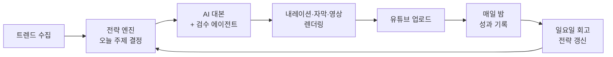
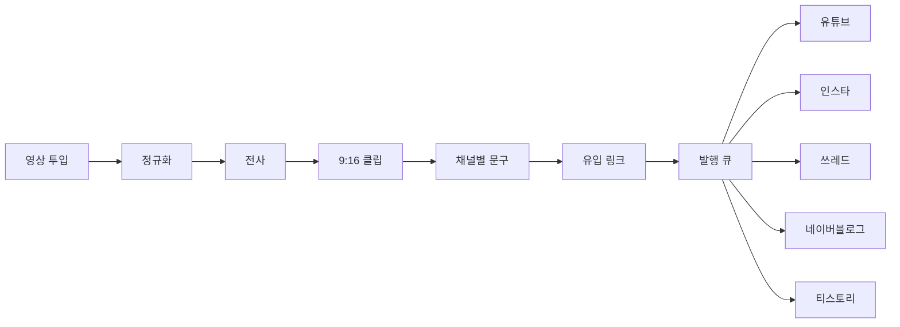

# 안녕하세요, 심재근입니다 👋

> 마지막 갱신: 2026-11-09 (내가 만든 프로젝트 기준으로 전체 재정리 · 1단2조 팀 프로젝트(nudy·집가) 종료 · 코인 봇 종료 · 유튜브 숫자 갱신) (이전 2026-10-27 이력서 링크 수정)

**AI 기능을 직접 구현하고, 그것이 매일 사람 없이 돌아가게 만드는 일**을 합니다.
알고리즘·웹·이미지 생성·자동화 운영·마케팅까지 한 흐름으로 다루며,
만든 뒤 지표로 검증하고 고치는 데까지가 제 일이라고 생각합니다.

**지금** — `심화_생성형 AI 활용 인재양성과정` 수료 (2026.08 – 2026.10).
AI 서비스 개발 · 백엔드 직무로 구직 중입니다.
📄 **[이력서 보기](https://github.com/jeakeun/show/tree/main/docs/이력서)**

## 📌 한눈에 보기

| 구분 | 프로젝트 | 한 줄 소개 | 상태 |
|---|---|---|---|
| 개인 | 🎬 **1분호기심** 유튜브 자동화 | 트렌드 → AI 대본 → 영상 렌더링 → 업로드 → 주간 회고까지 매일 2편 무인 발행 | 🟢 운영 중 (2026.08~) |
| 개인 | 📰 **AI데일리** | 매일 아침 AX 채용공고와 AI 논문·뉴스를 모아 쉬운 한글 리포트로 정리 | 🟢 운영 중 (2026.08~) |
| 개인 | 🧩 **jobfit-agent** | 공고 하나를 넣으면 근거가 달린 맞춤 지원서 초안을 만드는 멀티 에이전트 | 🟡 개발 중 (2026.10~) |
| 개인 | 💬 **market-compass** | 정보통신망법·카카오 정책 검사를 코드로 내장한 카카오 마케팅 메시지 에이전트 | 🟡 개발 중 (2026.09~) |
| 개인 | 🎭 **웹드라마 반자동** | AI 대본·편집·업로드는 자동, 장면 영상만 사람이 만드는 세로형 숏드라마 | 🟡 시험 중 (2026.10~) |
| 개인 | 🐱 **몽글이** 버추얼 스트리머 | 웹캠으로 얼굴·손을 따라 움직이는 고양이 캐릭터, OBS 방송용 | ✅ 완성 (2026.08) |
| 개인 | 🪙 **코인 모의투자 봇** | 가상 자금으로 10분 주기 전략 매매와 일일·주간 회고 | ⏹ 종료 (2026.09 – 11) |
| 팀 1단2조 | 💄 **nudy** | 한 부위씩 잡아주는 화장 코치. 촬영·메이크업 적용·생성 서버·마케팅 담당 | ✅ 완료 (2026.09 – 11) |
| 팀 1단2조 | 🏠 **집가(ZipGa)** | 모임 미니게임 웹앱. 마케팅 자동화(5채널 원클릭 발행) 단독 담당 | ✅ 완료 (2026.08 – 11) |
| 팀 | 🍽 **냠냠플래닛** | AI 식단 추천 + 웹캠 자세 분석 웹 서비스. AI 기능·연동 담당 | ✅ 완료 (2026.04 – 05) |

개인 프로젝트 개요와 운영 기록은 [jeakeun/show](https://github.com/jeakeun/show)에 있습니다.
(1분호기심·AI데일리·market-compass 코드는 비공개 저장소입니다)

---

## 🧩 할 수 있는 일

| 분야 | 실제로 한 일 |
|---|---|
| **AI 기능 구현** | KNN 기반 식단 추천 알고리즘 설계·고도화, **MediaPipe** 얼굴 인식 촬영과 실시간 자세 분석 |
| **LLM 에이전트** | 생성 → 검수 2단 구조, 근거 없는 문장을 잡는 검증가 에이전트, 숫자는 코드가·문장은 LLM이 맡는 역할 분리 |
| **이미지 생성 · GPU 최적화** | **FLUX**를 VRAM이 넉넉지 않은 **RTX 3060 서버**에서 돌리기 위해, 프롬프트를 **미리 임베딩으로 변환해 두고 생성**하는 방식으로 메모리 제약을 넘김 |
| **자동화 파이프라인** | 유튜브 매일 2편 무인 발행, 채용공고·논문 일일 수집 — 작업 스케줄러로 무인 운영, 실패하면 폰 알림 |
| **마케팅 · 그로스** | 채널을 직접 개설·운영하고 발행을 자동화. 매일 시장 조사를 모아 대시보드와 인사이트로 정리 |
| **규칙 · 가드 설계** | 정책 위반 표현 사후검사 후 자동 재생성, 정보통신망법·카카오 정책을 코드로 검사(Guard R01~R12) |
| **웹 개발** | Java · Spring Boot 백엔드, React · Axios 프론트, RESTful API 설계·연동 |
| **데이터 · 대시보드** | SQLite 허브에 매일 밤 통계 적재, KPI·추이 대시보드 자체 제작 |
| **미디어 처리** | FFmpeg 9:16 크롭·합성·음량 정규화, 단어 단위 자막, edge-tts 내레이션 |
| **게임 개발** | Unity · C# 2D/3D UI 및 게임 로직 수정·추가 (코드리치 인턴) |

---

## 🎬 1분호기심 — 유튜브 완전 자동화 (개인 · 운영 중)

심리학·뇌과학·행동경제학으로 일상을 풀어내는 지식 쇼츠 채널입니다. 기획·개발·운영을 혼자 맡고 있습니다.
→ [채널 보기](https://www.youtube.com/channel/UCQVL7FSlbK2p6AWxx9EfdUA)

| 숫자 (2026-11-09 기준) | |
|---|---|
| 하루 발행 | **2편** (아침 7시 · 저녁 6시) · 사람 개입 0 |
| 공개 영상 | **205편** (쇼츠 197 · 롱폼 8) |
| 총 조회수 | **138,337회** · 구독자 106명 |
| 정책 위반 · 플랫폼 제재 | **0건** |
| 외부 생성 API 비용 | **0원** (로컬 GPU) |

- 주제 반복·제목 규칙·의료 단어를 **코드로 강제**해 LLM 출력이 흔들리지 않게 함
- 생성 에이전트와 검수 에이전트를 나눠, 만든 쪽이 자기 결과물을 스스로 통과시키지 못하게 구성
- 일요일 회고 에이전트가 직전 전략을 스스로 채점하고, 성과 없는 전략은 ROI 0으로 판정해 중단
- 지난 쇼츠를 묶어 **8분 이상 몰아보기 롱폼**을 자동으로 만들고 수·토 저녁에 예약 공개 (2026-11~)
- 실패하면 폰 푸시 알림, 올린 영상이 사라지면 한 번 알림

## 📰 AI데일리 — 취업 정보 자동 수집 (개인 · 운영 중)

- 매일 07:00 AX/AI 채용공고 중 새 공고만 정리, 신입 가능·근무지 조건이 맞으면 「최우선 추천」으로 맨 위에
- 매일 08:00 HF Daily Papers · arXiv · AI 뉴스를 쉬운 한글로 요약
- "연속 0건" 같은 카운터는 AI가 세지 않고 코드가 데이터에서 계산
- 생성 후 검수 에이전트가 형식·링크·한글 깨짐을 다시 검사, 사용량 한도로 실패하면 자동 재실행

## 🧩 jobfit-agent — 공고 맞춤 지원서 멀티 에이전트 (개인 · 개발 중)

공고 → 요구사항 분석 → 경력 근거 검색(병렬) → 적합도 계산(코드) → 초안 작성 → **근거 검증** → 사람 확정.
LangGraph · RAG로 만들고 있으며, 모든 문장에 근거 번호가 붙고 근거 없는 문장은 검증가가 돌려보냅니다.
지원서 49세트를 사람이 검수하다 AI 말투가 그대로 남는 걸 보고 문체 검사(코드)와 오타·AI 말투 검증을 추가했습니다.
→ [show/jobfit-agent](https://github.com/jeakeun/show/tree/main/jobfit-agent)

## 💬 market-compass — 카카오 마케팅 메시지 에이전트 (개인 · 개발 중)

"지난달 안 온 단골에게 뭐 좀 보내줘"라고 말하면 대상 선정(Radar) · 규제 검사(Guard) · 발송(Dispatch)을 거쳐 나가는 에이전트입니다.

- 정보통신망법 · 카카오 정책 위반을 코드로 검사하는 규칙 12개(R01~R12) 설계
- 발송 경로를 한 곳으로 모으고 사람 승인 두 번을 거치게 해, 승인 없는 오발송을 차단
- 소상공인에게는 오발송 한 번이 곧 영업 손실이라 "자동"보다 "제재에 안 걸리는 것"을 먼저 설계

## 🎭 웹드라마 반자동 · 🐱 몽글이 (개인)

- **웹드라마**: Claude가 회당 90초 대본과 장면 지시문을 쓰고, 사람은 힉스필드에서 장면 영상만 만들면 자막·배경음악·편집·업로드와 10화 몰아보기 롱폼까지 자동. → [show/webdrama](https://github.com/jeakeun/show/tree/main/webdrama)
- **몽글이**: 브라우저에서 웹캠으로 얼굴·손을 따라 움직이는 고양이 캐릭터. 크로마키 배경으로 OBS에 얹어 방송. → [show/vtuber](https://github.com/jeakeun/show/tree/main/vtuber)

## 🪙 코인 모의투자 봇 (개인 · 종료)

거래소 계좌 없이 가상 자금 1,000만 원으로 10분 주기 전략 매매를 검증한 봇입니다.
손절·익절·하루 손실 한도·급락 가드를 코드로 강제하고, 주간 회고는 제안만 하고 사람이 골라 적용했습니다. 2026-11-02 운영을 끝냈습니다.

---

## 💄 nudy — 팀 1단2조 (완료)

한 부위씩 잡아주는 **화장 코치** 서비스입니다. 맨얼굴을 촬영하고, 룩을 얹어 본 뒤, 부위별로 그릴 자리를 보며 화장하고 점수를 받습니다.
→ [1DAN-2ZO/support-yr-makeup](https://github.com/1DAN-2ZO/support-yr-makeup)

제가 맡은 부분

- **첫 화면 촬영 기능** — MediaPipe로 얼굴을 인식해 촬영 화면을 구성하고, 촬영 이미지를 다음 단계로 전달
- **가상 메이크업 적용** — 촬영한 얼굴에 화장을 입혀 결과를 보여주는 기능
- **이미지 생성 서버 구성** — FLUX를 팀의 RTX 3060 서버에 올려 외부 생성 API 없이 동작
- **서비스 마케팅 단독 담당** — 마케팅 영상 14편을 **ComfyUI**로 제작하고 인스타·쓰레드·유튜브 3개 채널을 직접 개설·운영 ([youtube.com/@nudy.makeup](https://www.youtube.com/@nudy.makeup)), 매일 시장 조사를 대시보드와 인사이트로 정리

## 🏠 집가 (ZipGa) — 팀 1단2조 (완료)

링크·QR로 모여 미니게임을 하고, 점수가 낮으면 "집 가" 하고 카카오T가 뜨는 웹앱입니다. → [사이트](https://zip-ga-frontend.vercel.app/)
6인 팀에서 **마케팅 자동화를 단독으로** 맡아, 영상 생성부터 5개 채널 발행까지 하나의 파이프라인으로 만들었습니다.

- API가 연결되지 않은 채널은 **보조 모드로 자동 강등**(페이지 열기·문구 복사)해 한 채널 때문에 전체가 멈추지 않게 설계
- ComfyUI를 자동으로 띄워 로컬 GPU로 영상·BGM 생성 → 외부 생성 API 비용 0원
- 제재 예방 규칙(금지 표현·장면)을 정해 기획·프롬프트·해시태그를 일괄 교체 → 제재 0건

| 저장소 | 한 줄 소개 |
|---|---|
| [show/zipga-marketing](https://github.com/jeakeun/show/tree/main/zipga-marketing) | 제가 만든 마케팅 자동화 |
| [ZipGa_Frontend](https://github.com/1DAN-2ZO/ZipGa_Frontend) · [ZipGa_Backend](https://github.com/1DAN-2ZO/ZipGa_Backend) | 팀 웹앱 (Supabase Postgres + RLS + RPC 백엔드) |

## 🍽 냠냠플래닛 (YummyPlanet) — 팀 프로젝트 (완료)

신체 정보와 목표를 넣으면 AI가 하루 식단을 짜고, 웹캠으로 운동 자세를 분석하는 웹 서비스입니다. React + Spring Boot(MyBatis · MySQL) + FastAPI.
**→ [jeakeun/project](https://github.com/jeakeun/project)** (제가 맡은 부분을 README에 정리해 두었습니다) · 팀 원본 [YH-KIKI/YummyPlanet](https://github.com/YH-KIKI/YummyPlanet)

- **AI 식단 추천**: KNN이 칼로리 수치만 맞춰 조리되지 않은 재료를 추천하던 문제를,
  분류명 기반 카테고리 필터링과 목표 칼로리에 맞춘 섭취량(g) 자동 분배로 해결 → 밥·국·메인·반찬이 갖춰진 한 끼
- **실시간 자세 분석**: MediaPipe로 웹캠 관절 좌표를 추출하고, 프레임 단위 상태 관리를 최적화해 렌더링 지연 없이 피드백
- **API 연동**: Axios로 RESTful API 3개를 설계·연동해 프론트–백엔드 통신 구조 구축

---

## 🧰 주로 쓰는 것

`Python` · `Java` · `Spring Boot` · `React` · `Claude Code` · `LangGraph` · `FLUX / ComfyUI` · `MediaPipe` ·
`YouTube Data API` · `Meta Graph API` · `Threads API` · `FFmpeg` · `edge-tts` · `SQLite` · `Unity / C#` · `Windows Task Scheduler`

## 🎯 관심 분야

Vision AI · LLM 활용과 파인튜닝 · AI 에이전트 · 업무 자동화 · 그로스 마케팅

## 📄 이력서

[show/docs/이력서](https://github.com/jeakeun/show/tree/main/docs/이력서)에 정리해 두었습니다.
브라우저로 열어 `Ctrl + P` → PDF로 저장하면 됩니다. (개인정보는 비워 둔 상태입니다)

| 파일 | 설명 |
|---|---|
| `AX_심재근_이력서.html` | A안 — 왼쪽 라벨 정렬형 |
| `AX_심재근_이력서_디자인.html` | B안 — 사진 왼쪽, 섹션 번호·영문 병기, 프로젝트 2단 구성 |
| `AX_심재근_이력서_베일업.html` | AI 이미지 프로듀서 지원용 |
| `AX_심재근_이력서_베일업_영상.html` | AI 영상 프로듀서 지원용 |
| `자기소개서.md` | 성격 장단점 · 지원 동기 · 팀워크 · 입사 후 포부 |
