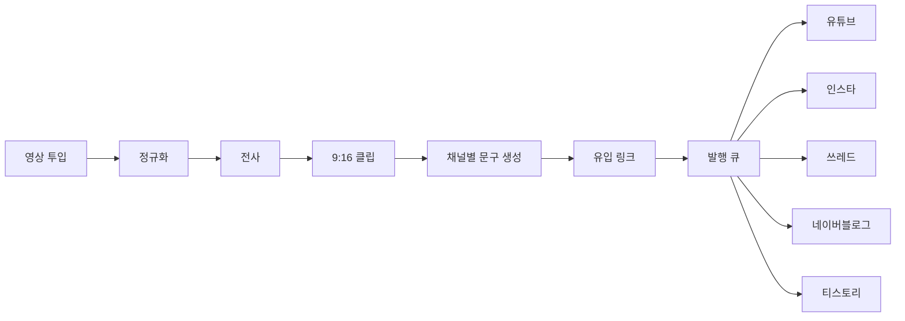

# 안녕하세요, 심재근입니다 👋

> 마지막 갱신: 2026-10-26 (영어 미러 채널 운영 종료 반영) (이전 2026-10-22 과정 수료·이력서 링크)

**AI 기능을 직접 구현하고, 그것이 매일 사람 없이 돌아가게 만드는 일**을 합니다.
알고리즘·웹·이미지 생성·자동화 운영·마케팅까지 한 흐름으로 다루며,
만든 뒤 지표로 검증하고 고치는 데까지가 제 일이라고 생각합니다.

**지금** — `심화_생성형 AI 활용 인재양성과정` 수료 (2026.08 – 2026.10).
AI 서비스 개발 · 백엔드 직무로 구직 중이며, 아래 자동화들은 지금도 매일 돌아가고 있습니다.
📄 **[이력서 보기](https://github.com/jeakeun/show/tree/main/docs/이력서)**

## 🧩 할 수 있는 일

| 분야 | 실제로 한 일 |
|---|---|
| **AI 기능 구현** | KNN 기반 식단 추천 알고리즘 설계·고도화, **MediaPipe** 얼굴 인식 촬영과 실시간 자세 분석 |
| **이미지 생성 · GPU 최적화** | **FLUX**를 VRAM이 넉넉지 않은 **RTX 3060 서버**에서 돌리기 위해, 프롬프트를 **미리 임베딩으로 변환해 두고 생성**하는 방식으로 메모리 제약을 넘김 |
| **마케팅 · 그로스** | 채널을 직접 개설·운영하고 발행을 자동화. 매일 시장 조사를 모아 대시보드와 인사이트로 정리 |
| **웹 개발** | Java · Spring Boot 백엔드, React · Axios 프론트, RESTful API 설계·연동 |
| **자동화 파이프라인** | 유튜브 매일 2편 무인 발행, 채용공고·논문 일일 수집, 코인 모의매매 — 전부 작업 스케줄러로 무인 운영 |
| **규칙 · 가드 설계** | 정책 위반 표현 사후검사 후 자동 재생성, 정보통신망법·카카오 정책을 코드로 검사(Guard R01~R12) |
| **데이터 · 대시보드** | SQLite 허브에 매일 밤 통계 적재, KPI·추이 대시보드 자체 제작 |
| **미디어 처리** | FFmpeg 9:16 크롭·합성·음량 정규화, 단어 단위 자막, edge-tts 내레이션 |
| **게임 개발** | Unity · C# 2D/3D UI 및 게임 로직 수정·추가 (코드리치 인턴) |

---

## 📈 마케팅 · 콘텐츠 운영

직접 개설하고 운영 중인 채널입니다. 발행은 사람이 누르지 않습니다.

### 숫자

| | |
|---|---|
| 운영 채널 | **9개** (3개 서비스) |
| 하루 발행 | **2편** · 사람 개입 0 |
| 누적 발행 | **50편 +** |
| 일평균 조회 | **2,175회** |
| 발행 실패 · 플랫폼 제재 | **0건** |
| 외부 생성 API 비용 | **0원** (로컬 GPU) |

### 서비스별 채널

| 서비스 | 채널 | 수 |
|---|---|---|
| **집가(ZipGa)** | 유튜브 · 인스타 · 쓰레드 · 네이버블로그 · 티스토리 | `█████` 5 |
| **nudy** | 인스타 · 쓰레드 · 유튜브 | `███` 3 |
| **1분호기심** | 한국 채널 | `█` 1 |

### 발행 파이프라인 (집가)

영상 파일을 폴더에 넣고 실행하면 5개 채널까지 한 번에 나갑니다.

> API가 연결되지 않은 채널은 **보조 모드로 자동 강등**되어 페이지 열기와 문구 복사까지 수행합니다.
> 한 채널의 승인 지연이 전체를 멈추지 않게 하는 것이 설계의 핵심이었습니다.

### 운영 규칙

- 플랫폼 제재 예방을 위해 공개 문구·영상에서 **금지 표현과 장면을 규칙으로 정의**하고
  기획 데이터·프롬프트·해시태그를 일괄 교체 → **제재 0건**
- 성과는 매일 수집하고, 주간 회고가 전략을 스스로 채점해 갱신
  (성과 없는 롱폼 전략은 **ROI 0으로 판정해 중단**)

---

## 🤝 1단2조 (1DAN-2ZO) — 현재 팀 프로젝트 **nudy**

촬영한 얼굴에 **가상으로 메이크업을 입혀 보여주는 서비스**입니다. → [github.com/1DAN-2ZO](https://github.com/1DAN-2ZO)

제가 맡은 부분

- **첫 화면 촬영 기능** — MediaPipe로 얼굴을 인식해 촬영 화면을 구성하고, 촬영 이미지를 다음 단계로 전달
- **가상 메이크업 적용** — 촬영한 얼굴에 화장을 입혀 결과를 보여주는 기능
- **이미지 생성 서버 구성** — FLUX를 팀의 RTX 3060 서버에 올려 외부 생성 API 없이 동작
- **서비스 마케팅 단독 담당** — 인스타·쓰레드·유튜브 3개 채널 개설·운영, 매일 시장 조사를 대시보드와 인사이트로 정리

---

## 🎬 개인 프로젝트

전부 메인 PC의 윈도우 작업 스케줄러에서 매일 자동으로 돌아갑니다.
개요와 운영 기록은 [jeakeun/show](https://github.com/jeakeun/show)에 있습니다.

| 프로젝트 | 한 줄 소개 | 상태 |
|---|---|---|
| 🎬 **1분호기심** 유튜브 자동화 | 트렌드 → AI 대본 → 영상 렌더링 → 자동 업로드까지 매일 2편. 일요일 회고가 전략을 스스로 채점·갱신 | 운영 중 (2026-08~) |
| 📰 **AI데일리** | 매일 아침 AX 채용공고와 AI 논문·뉴스를 수집해 쉬운 한글 리포트로 정리. 검수 에이전트가 형식·링크를 재검사 | 운영 중 (2026-08~) |
| 🪙 **코인 모의투자 봇** | 가상 자금으로 10분 주기 전략 매매 + 일일·주간 회고. 손절·한도 등 안전장치를 코드로 강제 | 모의투자 검증 중 |
| 💬 **market-compass** | 정보통신망법·카카오 정책 검사를 코드로 내장한 카카오 마케팅 메시지 에이전트 (Radar / Guard / Dispatch) | 개발 중 |

**운영 원칙** — 자동화를 수집 / 규칙 / 분석 / 실행 네 칸으로 나누고, 분석 AI는 제안만 합니다.
되돌릴 수 있는 변경은 자동 적용 후 보고하고, 돈·정책처럼 사람이 정할 것은 선택지로 올립니다.

---

## 🍽 냠냠플래닛 (YummyPlanet) — 팀 프로젝트

AI 식단 관리 웹 서비스입니다. React + Spring Boot(MyBatis · MySQL) + FastAPI 구성.
**→ [jeakeun/project](https://github.com/jeakeun/project)** (제가 맡은 부분을 README에 정리해 두었습니다)

- **AI 식단 추천 알고리즘**: KNN이 칼로리 수치만 맞춰 조리되지 않은 재료를 추천하던 문제를,
  분류명 기반 카테고리 필터링과 목표 칼로리에 맞춘 섭취량(g) 자동 분배로 해결
  → 밥·국·메인·반찬이 갖춰진 한 끼 출력
- **실시간 자세 분석**: MediaPipe로 웹캠 관절 좌표를 추출하고, 프레임 단위 상태 관리를 최적화해 렌더링 지연 없이 피드백
- 팀 원본: [YH-KIKI/YummyPlanet](https://github.com/YH-KIKI/YummyPlanet)

## 🏠 집가 (ZipGa) — 팀 1단2조

링크·QR로 모여 미니게임을 하고, 점수가 낮으면 "집 가" 하고 카카오T가 뜨는 웹앱입니다.
6인 팀에서 **마케팅 자동화 파트**를 맡아, 영상 생성부터 5개 채널 발행까지를 하나의 파이프라인으로 만들었습니다.
→ [사이트](https://zip-ga-frontend.vercel.app/)

| 저장소 | 한 줄 소개 |
|---|---|
| [ZipGa_Frontend](https://github.com/1DAN-2ZO/ZipGa_Frontend) | 집 가 웹앱 프런트엔드 |
| [ZipGa_Backend](https://github.com/1DAN-2ZO/ZipGa_Backend) | 서버 언어 없이 Supabase Postgres + RLS + RPC 만으로 구성한 백엔드 |
| [show/zipga-marketing](https://github.com/jeakeun/show/tree/main/zipga-marketing) | 제가 만든 마케팅 자동화. 로컬 GPU(ComfyUI · FLUX)로 영상·이미지 생성 → 문구 생성 → 5개 채널 원클릭 발행 |

## 🧰 주로 쓰는 것

`Java` · `Spring Boot` · `React` · `Python` · `Claude Code` · `FLUX / ComfyUI` · `MediaPipe` ·
`YouTube Data API` · `Meta Graph API` · `Threads API` · `FFmpeg` · `edge-tts` · `SQLite` · `Unity / C#` · `Windows Task Scheduler`

## 🎯 관심 분야

Vision AI · LLM 활용과 파인튜닝 · AI 에이전트 · 업무 자동화 · 그로스 마케팅

## 📄 이력서

[show/docs/이력서](https://github.com/jeakeun/show/tree/main/docs/이력서)에 두 가지 배치로 정리해 두었습니다.
브라우저로 열어 `Ctrl + P` → PDF로 저장하면 됩니다. (개인정보는 비워 둔 상태입니다)

| 파일 | 설명 |
|---|---|
| `AX_심재근_이력서.html` | A안 — 왼쪽 라벨 정렬형 |
| `AX_심재근_이력서_디자인.html` | B안 — 사진 왼쪽, 섹션 번호·영문 병기, 프로젝트 2단 구성 |
| `자기소개서.md` | 성격 장단점 · 지원 동기 · 팀워크 · 입사 후 포부 |

---

📺 [1분호기심 채널](https://www.youtube.com/channel/UCQVL7FSlbK2p6AWxx9EfdUA)
